# Raja Purwanto

**Web developer pemula yang ingin terus berkembang.** Saya belajar lewat proyek yang bisa dicoba, mulai dari interaksi JavaScript di browser hingga alur login dan pencatatan data dengan PHP. Di luar web, saya juga bereksperimen dengan game 2D di Godot.

## Peta proyek

## Proyek pilihan

- **[Absensi Pintar](https://github.com/RajaPurwa2810-Mpry/website-absensi)** · Proyek individu untuk ujian praktik. Siswa menampilkan QR, guru memindainya, dan kehadiran tercatat di rekap harian. README memuat tangkapan layar, akun demo, dan panduan menjalankan proyek di XAMPP.
- **[FlacTopus AI](https://github.com/RajaPurwa2810-Mpry/FlacTopus-finall)** · Proyek tim untuk OSCAR 3.0. Saya berkontribusi pada ide dan perancangan alur belajar. Tim mengembangkan platform pembelajaran berbasis *skill tree* dengan tutor AI.
- **[Cetrek Cetrek Lampu](https://github.com/RajaPurwa2810-Mpry/cetrek-cetrek-lampu)** · Latihan JavaScript DOM dari CuyUniversity. Tiga saklar mengubah keadaan tiga lampu secara independen. Proyek dapat dicoba dengan membuka `index.html`.
- **[Godot 2D RPG](https://github.com/RajaPurwa2810-Mpry/godot-2d-rpg)** · Prototipe belajar dari tutorial DevWorm. Saya menyusun layout peta dan menggabungkan pertarungan, inventory, dialog NPC, serta quest mengumpulkan tiga ranting.

## Teknologi yang saya pakai

- **Web** · HTML, CSS, dan JavaScript untuk antarmuka serta interaksi di browser. PHP dan MariaDB untuk login dan penyimpanan absensi.
- **Game** · Godot 4.6 dan GDScript untuk mempelajari scene, input, dan mekanik permainan.

## Kompetisi

- **OSCAR 3.0 · Web Development** — Top 15 dan nominasi terkreatif bersama tim FlacTopus AI.
