

  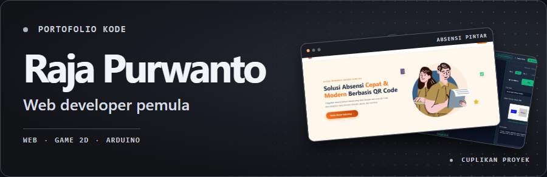

## Teknologi

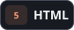 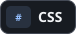 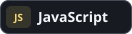 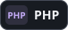 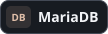 
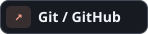 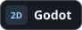  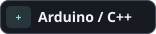

## Proyek pilihan

  <a href="https://github.com/RajaPurwa2810-Mpry/website-absensi">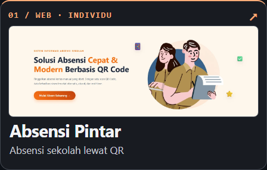</a>
  <a href="https://github.com/RajaPurwa2810-Mpry/FlacTopus-finall">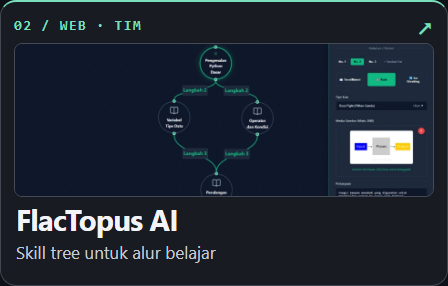</a>

  <a href="https://github.com/RajaPurwa2810-Mpry/cetrek-cetrek-lampu">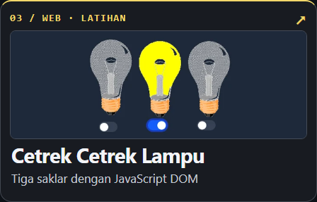</a>
  <a href="https://github.com/RajaPurwa2810-Mpry/godot-2d-rpg">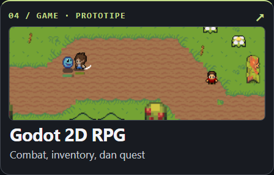</a>

  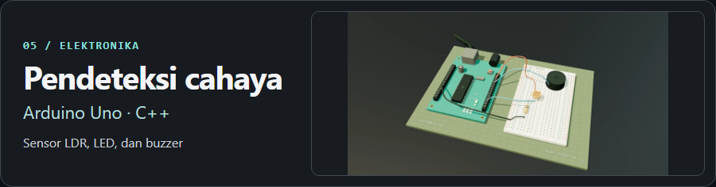

<strong>Lihat model Arduino</strong>

  <picture>
    <source media="(prefers-reduced-motion: reduce)" srcset="./assets/arduino-preview.webp">
    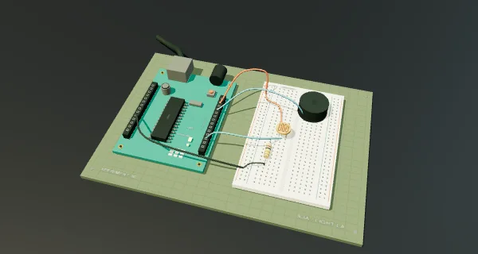
  </picture>

[Putar sendiri di penampil STL GitHub](./assets/arduino-model.stl) · Geometri model dalam satu warna.

## Prestasi

  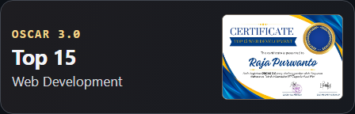
  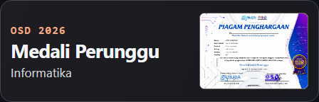

<strong>Lihat bukti OSCAR 3.0</strong>

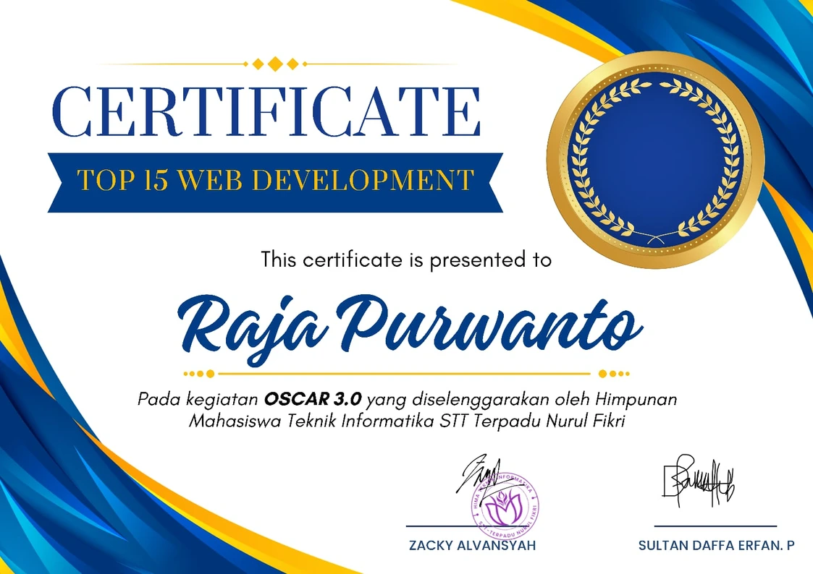

Himpunan Mahasiswa Teknik Informatika STT Terpadu Nurul Fikri · Proyek tim FlacTopus AI

<strong>Lihat bukti OSD 2026</strong>

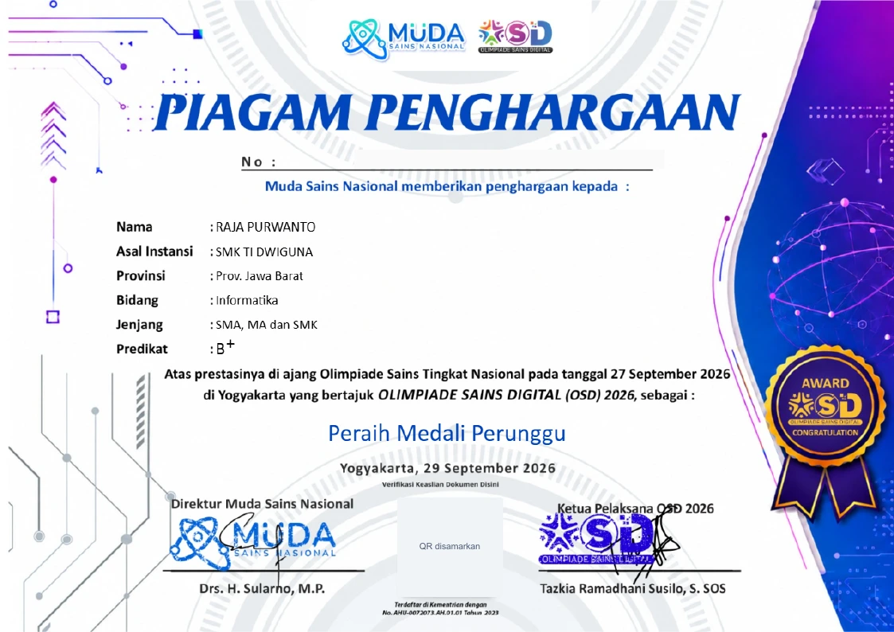

Olimpiade Sains Digital 2026 · Muda Sains Nasional

